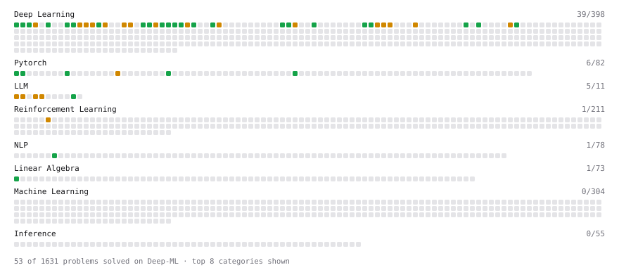

# Deep-ML

My machine learning practice from [Deep-ML](https://www.deep-ml.com). Every solution here was written by hand.

**89** solved · 89 problems · 0 labs · 0 math

[**Browse the interactive portfolio**](https://madhavagrawal356-netizen.github.io/deep-ml/) to replay this filling in over time.

## Problems

| | Difficulty | Solved | |
| --- | --- | --- | --- |
| [Adamax Optimizer](https://www.deep-ml.com/problems/148) | easy | 2026-09-24 | [solution](problems/0148-adamax-optimizer) |
| [Calculate Computational Efficiency of MoE](https://www.deep-ml.com/problems/123) | easy | 2026-09-10 | [solution](problems/0123-calculate-computational-efficiency-of-moe) |
| [Calculate Unigram Probability from Corpus](https://www.deep-ml.com/problems/129) | easy | 2026-09-17 | [solution](problems/0129-calculate-unigram-probability-from-corpus) |
| [Conv2d Output Shape](https://www.deep-ml.com/problems/1232) | easy | 2026-10-03 | [solution](problems/1232-conv2d-output-shape) |
| [Create a Float Tensor from a Python List](https://www.deep-ml.com/problems/880) | easy | 2026-10-03 | [solution](problems/0880-create-a-float-tensor-from-a-python-list) |
| [Derivative of a Polynomial](https://www.deep-ml.com/problems/116) | easy | 2026-10-17 | [solution](problems/0116-derivative-of-a-polynomial) |
| [Derivatives of Activation Functions](https://www.deep-ml.com/problems/217) | easy | 2026-09-19 | [solution](problems/0217-derivatives-of-activation-functions) |
| [Early Stopping with Patience](https://www.deep-ml.com/problems/913) | easy | 2026-10-13 | [solution](problems/0913-early-stopping-with-patience) |
| [Exponential Weighted Average of Rewards](https://www.deep-ml.com/problems/161) | easy | 2026-10-22 | [solution](problems/0161-exponential-weighted-average-of-rewards) |
| [GeLU Activation Function ](https://www.deep-ml.com/problems/147) | easy | 2026-09-29 | [solution](problems/0147-gelu-activation-function) |
| [Implement a Simple Residual Block with Shortcut Connection](https://www.deep-ml.com/problems/113) | easy | 2026-09-21 | [solution](problems/0113-implement-a-simple-residual-block-with-shortcut-connection) |
| [Implement He Weight Initialization](https://www.deep-ml.com/problems/290) | easy | 2026-09-21 | [solution](problems/0290-implement-he-weight-initialization) |
| [Implement ReLU Activation Function](https://www.deep-ml.com/problems/42) | easy | 2026-09-06 | [solution](problems/0042-implement-relu-activation-function) |
| [Implement SwiGLU activation function](https://www.deep-ml.com/problems/156) | easy | 2026-09-08 | [solution](problems/0156-implement-swiglu-activation-function) |
| [Implement the ELU Activation Function](https://www.deep-ml.com/problems/97) | easy | 2026-09-07 | [solution](problems/0097-implement-the-elu-activation-function) |
| [Implement the Hard Sigmoid Activation Function](https://www.deep-ml.com/problems/96) | easy | 2026-09-07 | [solution](problems/0096-implement-the-hard-sigmoid-activation-function) |
| [Implement the Hardtanh Activation Function](https://www.deep-ml.com/problems/266) | easy | 2026-09-20 | [solution](problems/0266-implement-the-hardtanh-activation-function) |
| [Implement the SELU Activation Function](https://www.deep-ml.com/problems/103) | easy | 2026-09-11 | [solution](problems/0103-implement-the-selu-activation-function) |
| [Implement the Softplus Activation Function](https://www.deep-ml.com/problems/99) | easy | 2026-09-09 | [solution](problems/0099-implement-the-softplus-activation-function) |
| [Implement the Softsign Activation Function](https://www.deep-ml.com/problems/100) | easy | 2026-09-09 | [solution](problems/0100-implement-the-softsign-activation-function) |
| [Implement the Swish Activation Function](https://www.deep-ml.com/problems/102) | easy | 2026-09-09 | [solution](problems/0102-implement-the-swish-activation-function) |
| [Implement the Tanh Activation Function](https://www.deep-ml.com/problems/264) | easy | 2026-09-10 | [solution](problems/0264-implement-the-tanh-activation-function) |
| [Implementation of Log Softmax Function](https://www.deep-ml.com/problems/39) | easy | 2026-09-04 | [solution](problems/0039-implementation-of-log-softmax-function) |
| [KL Divergence Between Two Normal Distributions](https://www.deep-ml.com/problems/56) | easy | 2026-09-06 | [solution](problems/0056-kl-divergence-between-two-normal-distributions) |
| [Leaky ReLU Activation Function](https://www.deep-ml.com/problems/44) | easy | 2026-09-06 | [solution](problems/0044-leaky-relu-activation-function) |
| [Matrix-Vector Dot Product](https://www.deep-ml.com/problems/1) | easy | 2026-09-23 | [solution](problems/0001-matrix-vector-dot-product) |
| [Reshape and Transpose a Tensor](https://www.deep-ml.com/problems/881) | easy | 2026-10-03 | [solution](problems/0881-reshape-and-transpose-a-tensor) |
| [Save and Load Model Weights with state_dict](https://www.deep-ml.com/problems/888) | easy | 2026-10-13 | [solution](problems/0888-save-and-load-model-weights-with-state-dict) |
| [Sigmoid Activation Function Understanding](https://www.deep-ml.com/problems/22) | easy | 2026-09-04 | [solution](problems/0022-sigmoid-activation-function-understanding) |
| [Single Linear Neuron Forward](https://www.deep-ml.com/problems/1224) | easy | 2026-10-16 | [solution](problems/1224-single-linear-neuron-forward) |
| [Single Neuron](https://www.deep-ml.com/problems/24) | easy | 2026-09-04 | [solution](problems/0024-single-neuron) |
| [Softmax Activation Function Implementation ](https://www.deep-ml.com/problems/23) | easy | 2026-09-04 | [solution](problems/0023-softmax-activation-function-implementation) |
| [Sycophancy Rate from Paired Belief Prompts](https://www.deep-ml.com/problems/1334) | easy | 2026-09-16 | [solution](problems/1334-sycophancy-rate-from-paired-belief-prompts) |
| [Thanksgiving Feast Predictor: Softmax for Dish Selection](https://www.deep-ml.com/problems/216) | easy | 2026-09-08 | [solution](problems/0216-thanksgiving-feast-predictor-softmax-for-dish-selection) |
| [A collate_fn for Variable-Length Sequences](https://www.deep-ml.com/problems/1348) | medium | 2026-10-22 | [solution](problems/1348-a-collate-fn-for-variable-length-sequences) |
| [Adadelta Optimizer](https://www.deep-ml.com/problems/149) | medium | 2026-09-07 | [solution](problems/0149-adadelta-optimizer) |
| [Adam Optimizer](https://www.deep-ml.com/problems/87) | medium | 2026-09-07 | [solution](problems/0087-adam-optimizer) |
| [Apply a 2D Convolution](https://www.deep-ml.com/problems/1233) | medium | 2026-10-15 | [solution](problems/1233-apply-a-2d-convolution) |
| [Binary Cross-Entropy from Logits](https://www.deep-ml.com/problems/1229) | medium | 2026-10-21 | [solution](problems/1229-binary-cross-entropy-from-logits) |
| [Compute the Hessian Matrix](https://www.deep-ml.com/problems/218) | medium | 2026-09-24 | [solution](problems/0218-compute-the-hessian-matrix) |
| [Derivative of Softmax](https://www.deep-ml.com/problems/219) | medium | 2026-10-18 | [solution](problems/0219-derivative-of-softmax) |
| [Direct Preference Optimization (DPO) Loss](https://www.deep-ml.com/problems/382) | medium | 2026-10-18 | [solution](problems/0382-direct-preference-optimization-dpo-loss) |
| [Dropout in Train vs Eval Mode](https://www.deep-ml.com/problems/1230) | medium | 2026-10-15 | [solution](problems/1230-dropout-in-train-vs-eval-mode) |
| [Dropout Layer](https://www.deep-ml.com/problems/151) | medium | 2026-10-19 | [solution](problems/0151-dropout-layer) |
| [Epsilon-Greedy Action Selection for n-Armed Bandit](https://www.deep-ml.com/problems/158) | medium | 2026-09-20 | [solution](problems/0158-epsilon-greedy-action-selection-for-n-armed-bandit) |
| [Filter, Group, and Aggregate a DataFrame (Top-10 by Metric)](https://www.deep-ml.com/problems/1127) | medium | 2026-10-16 | [solution](problems/1127-filter-group-and-aggregate-a-dataframe-top-10-by-metric) |
| [Forward Diffusion Process](https://www.deep-ml.com/problems/303) | medium | 2026-10-19 | [solution](problems/0303-forward-diffusion-process) |
| [Gradient of a Weighted Sum of Squares](https://www.deep-ml.com/problems/1223) | medium | 2026-10-16 | [solution](problems/1223-gradient-of-a-weighted-sum-of-squares) |
| [Implement a ResNet Basic Block](https://www.deep-ml.com/problems/917) | medium | 2026-10-14 | [solution](problems/0917-implement-a-resnet-basic-block) |
| [Implement a Transformer Encoder Block](https://www.deep-ml.com/problems/905) | medium | 2026-10-03 | [solution](problems/0905-implement-a-transformer-encoder-block) |
| [Implement Adam Optimization Algorithm](https://www.deep-ml.com/problems/49) | medium | 2026-09-06 | [solution](problems/0049-implement-adam-optimization-algorithm) |
| [Implement AdamW Optimizer Step](https://www.deep-ml.com/problems/169) | medium | 2026-10-16 | [solution](problems/0169-implement-adamw-optimizer-step) |
| [Implement an LSTM Cell from Scratch](https://www.deep-ml.com/problems/907) | medium | 2026-10-14 | [solution](problems/0907-implement-an-lstm-cell-from-scratch) |
| [Implement Focal Loss](https://www.deep-ml.com/problems/915) | medium | 2026-10-20 | [solution](problems/0915-implement-focal-loss) |
| [Implement Long Short-Term Memory (LSTM) Network](https://www.deep-ml.com/problems/59) | medium | 2026-09-06 | [solution](problems/0059-implement-long-short-term-memory-lstm-network) |
| [Implement Masked Self-Attention](https://www.deep-ml.com/problems/107) | medium | 2026-09-08 | [solution](problems/0107-implement-masked-self-attention) |
| [Implement PReLU Forward and Backward Pass](https://www.deep-ml.com/problems/98) | medium | 2026-09-08 | [solution](problems/0098-implement-prelu-forward-and-backward-pass) |
| [Implement Q-Learning Algorithm for MDPs](https://www.deep-ml.com/problems/133) | medium | 2026-10-22 | [solution](problems/0133-implement-q-learning-algorithm-for-mdps) |
| [Implement Self-Attention Mechanism](https://www.deep-ml.com/problems/53) | medium | 2026-09-09 | [solution](problems/0053-implement-self-attention-mechanism) |
| [Implement the Noisy Top-K Gating Function](https://www.deep-ml.com/problems/124) | medium | 2026-09-09 | [solution](problems/0124-implement-the-noisy-top-k-gating-function) |
| [Implement Xavier/Glorot Weight Initialization](https://www.deep-ml.com/problems/289) | medium | 2026-09-29 | [solution](problems/0289-implement-xavier-glorot-weight-initialization) |
| [Implementing a Simple RNN](https://www.deep-ml.com/problems/54) | medium | 2026-09-06 | [solution](problems/0054-implementing-a-simple-rnn) |
| [Jacobian Matrix Calculation](https://www.deep-ml.com/problems/202) | medium | 2026-10-18 | [solution](problems/0202-jacobian-matrix-calculation) |
| [LoRA: Low-Rank Adaptation Forward Pass](https://www.deep-ml.com/problems/222) | medium | 2026-09-20 | [solution](problems/0222-lora-low-rank-adaptation-forward-pass) |
| [Math Answer Verification with Equivalence Checking](https://www.deep-ml.com/problems/319) | medium | 2026-09-20 | [solution](problems/0319-math-answer-verification-with-equivalence-checking) |
| [MMLU Log-Probability Scoring](https://www.deep-ml.com/problems/316) | medium | 2026-09-16 | [solution](problems/0316-mmlu-log-probability-scoring) |
| [Newton's Method for Optimization](https://www.deep-ml.com/problems/221) | medium | 2026-10-17 | [solution](problems/0221-newton-s-method-for-optimization) |
| [nn.ModuleList vs a Plain Python List](https://www.deep-ml.com/problems/1341) | medium | 2026-10-15 | [solution](problems/1341-nn-modulelist-vs-a-plain-python-list) |
| [One Adam Update Step](https://www.deep-ml.com/problems/1236) | medium | 2026-10-21 | [solution](problems/1236-one-adam-update-step) |
| [One Training Step](https://www.deep-ml.com/problems/1219) | medium | 2026-10-20 | [solution](problems/1219-one-training-step) |
| [Pairwise Preference Judge for LLM Comparison](https://www.deep-ml.com/problems/323) | medium | 2026-09-23 | [solution](problems/0323-pairwise-preference-judge-for-llm-comparison) |
| [QLoRA: Quantized Low-Rank Adaptation Forward Pass](https://www.deep-ml.com/problems/223) | medium | 2026-09-21 | [solution](problems/0223-qlora-quantized-low-rank-adaptation-forward-pass) |
| [Rubric-Based LLM Judge Evaluation](https://www.deep-ml.com/problems/317) | medium | 2026-09-20 | [solution](problems/0317-rubric-based-llm-judge-evaluation) |
| [SGD with Momentum Step](https://www.deep-ml.com/problems/1235) | medium | 2026-10-15 | [solution](problems/1235-sgd-with-momentum-step) |
| [Single Neuron with Backpropagation](https://www.deep-ml.com/problems/25) | medium | 2026-09-04 | [solution](problems/0025-single-neuron-with-backpropagation) |
| [Temperature Decay Scheduler](https://www.deep-ml.com/problems/231) | medium | 2026-09-08 | [solution](problems/0231-temperature-decay-scheduler) |
| [The Pattern Weaver's Code](https://www.deep-ml.com/problems/89) | medium | 2026-09-07 | [solution](problems/0089-the-pattern-weaver-s-code) |
| [Two-Layer MLP Forward Pass](https://www.deep-ml.com/problems/1225) | medium | 2026-10-21 | [solution](problems/1225-two-layer-mlp-forward-pass) |
| [A/B Test Statistical Analysis for Model Comparison](https://www.deep-ml.com/problems/269) | hard | 2026-10-17 | [solution](problems/0269-a-b-test-statistical-analysis-for-model-comparison) |
| [Build a Tiny GPT](https://www.deep-ml.com/problems/918) | hard | 2026-10-14 | [solution](problems/0918-build-a-tiny-gpt) |
| [Build a Transformer Encoder Layer](https://www.deep-ml.com/problems/491) | hard | 2026-10-19 | [solution](problems/0491-build-a-transformer-encoder-layer) |
| [Causal and Padding Masks with scaled_dot_product_attention](https://www.deep-ml.com/problems/1346) | hard | 2026-10-15 | [solution](problems/1346-causal-and-padding-masks-with-scaled-dot-product-attention) |
| [Decision Tree Learning](https://www.deep-ml.com/problems/20) | hard | 2026-10-16 | [solution](problems/0020-decision-tree-learning) |
| [Implement Multi-Head Attention](https://www.deep-ml.com/problems/94) | hard | 2026-10-17 | [solution](problems/0094-implement-multi-head-attention) |
| [Implement Multi-Head Self-Attention](https://www.deep-ml.com/problems/904) | hard | 2026-10-14 | [solution](problems/0904-implement-multi-head-self-attention) |
| [Implement the GRPO Objective Function](https://www.deep-ml.com/problems/101) | hard | 2026-10-22 | [solution](problems/0101-implement-the-grpo-objective-function) |
| [Preference Dataset Collate Function for DPO](https://www.deep-ml.com/problems/1069) | hard | 2026-10-20 | [solution](problems/1069-preference-dataset-collate-function-for-dpo) |
| [Trade Compute for Memory with Gradient Checkpointing](https://www.deep-ml.com/problems/1342) | hard | 2026-10-15 | [solution](problems/1342-trade-compute-for-memory-with-gradient-checkpointing) |
| [Two-Sample T-Test Implementation](https://www.deep-ml.com/problems/211) | hard | 2026-10-22 | [solution](problems/0211-two-sample-t-test-implementation) |

---

_This file is regenerated by Deep-ML on every push._
